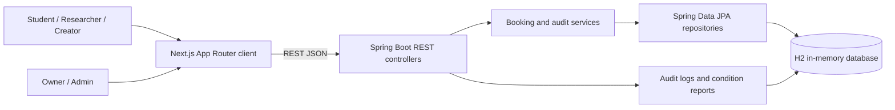

# ShareVault

## Institutional Resource Sharing Platform

ShareVault is a trust-first resource sharing platform for universities, research institutions, makerspaces, and similar organizations. It helps students, researchers, creators, and asset managers share labs, equipment, and spaces without losing control of safety, fairness, or accountability.

---

## 1. Selected Use Case

Institutions own expensive and often underused resources: fabrication labs, microscopes, testing equipment, studios, conference rooms, and specialized workspaces. Today, access is frequently coordinated through email, spreadsheets, personal messages, and informal approvals. This creates three recurring problems:

- **Trust:** people cannot easily verify whether a requester is qualified to use a hazardous or specialized resource.
- **Safety:** condition checks, damage reporting, and ownership accountability are inconsistent or undocumented.
- **Operations:** double bookings, unfair usage, lost audit trails, and manual waiting lists consume staff time.

ShareVault addresses these problems with a single lifecycle for discovering resources, proving eligibility, requesting access, reviewing requests, checking in, using the resource, returning it, and auditing every material decision.

### Why this use case matters

Institutional resources are high-value, safety-sensitive, and shared by many people. A lightweight booking form is not enough. The platform must also answer:

- Who is allowed to use this resource?
- Who approved the request, and why?
- Is the resource already committed during the requested time?
- Has this user exceeded a fair-use limit?
- What condition was the resource in before and after use?
- What happens when a resource is returned late, damaged, or unavailable?
- Can an administrator reconstruct the full history later?

ShareVault treats the booking as an auditable chain of custody rather than a simple calendar reservation.

---

## 2. Target Users & Owners

### Target users

| User group | Needs | How ShareVault helps |
| --- | --- | --- |
| Students | Access to labs, equipment, and project spaces without lengthy email chains | Self-service discovery, eligibility checks, and booking requests |
| Researchers | Reliable access to specialized instruments and controlled environments | Qualification requirements, conflict detection, and usage limits |
| Creators and makers | Access to fabrication tools, studios, and production equipment | Transparent availability, waiting lists, and condition reporting |
| Teaching assistants and lab staff | Coordinate usage without losing safety records | Check-in/check-out reports and auditable activity history |
| Institutional administrators | Enforce policy and resolve disputes | Audit logs, role-aware reviews, and operational oversight |

### Resource owners and asset managers

| Owner group | Responsibilities | Platform support |
| --- | --- | --- |
| Lab managers | Publish resources, set qualifications, approve or reject requests | Resource listing, owner review desk, decision reasons |
| Equipment owners | Protect high-value assets and monitor damage | Condition reports, damage escalation, audit trail |
| Space managers | Coordinate rooms and shared facilities | Availability, time-window conflict checks, weekly limits |
| Institutional administrators | Govern access and review operational history | Admin review authority and complete audit logs |

---

## 3. Core Solution & Workflow

ShareVault provides a ten-step lifecycle from resource listing to return confirmation. Each step produces a status change, an audit event, or both.

### The 10-step lifecycle

| Step | Stage | Primary actor | What happens | Record produced |
| --- | --- | --- | --- | --- |
| 1 | **Resource listing** | Owner / asset manager | The owner publishes a resource with title, category, description, location, hourly rate, availability, mandatory qualification, and maximum weekly hours. | Resource record |
| 2 | **Discovery and filtering** | Requester | Users search and filter resources by category, location, and availability. | Resource search result |
| 3 | **Eligibility screening** | Requester | The requester checks whether their qualifications match the resource requirement. The prototype supports a rule-based eligibility check. | Eligibility result |
| 4 | **Booking request submission** | Requester | The requester selects a time window and submits a request with a qualification proof and user ID. | Booking in `PENDING` status |
| 5 | **Conflict and fair-use checks** | System | The system checks overlapping active bookings and the requester's weekly usage against the resource limit. Conflicting requests enter the waiting list. | `WAITLISTED` booking or `PENDING` booking |
| 6 | **Owner or admin review** | Owner / admin | The resource owner or an administrator reviews the request and records an approval or rejection with a reason. | `APPROVED` or `REJECTED` booking plus audit log |
| 7 | **Approval and scheduling** | System / owner | Approved requests become scheduled sessions. The decision and reason remain visible in the audit history. | `BOOKING_APPROVED` or `BOOKING_REJECTED` audit event |
| 8 | **Check-in** | Requester | At the start of use, the requester records condition notes and an optional photo URL. | `CHECKED_IN` status and check-in condition report |
| 9 | **Usage and monitoring** | Requester / owner | The resource is in active use. The platform retains the approved time window, actor, and condition baseline for accountability. | Active session and audit history |
| 10 | **Check-out and return confirmation** | Requester | The requester records return condition, optional photo evidence, and a damage flag. The resource returns to the pool and the next waiting user is promoted. | `RETURNED` status, check-out report, and audit events |

### Lifecycle status flow

```text
PENDING
  |-- review approve --> APPROVED -- check-in --> CHECKED_IN -- check-out --> RETURNED
  |-- review reject ---> REJECTED
  |-- conflict --------> WAITLISTED -- promotion --> PENDING

CANCELLED is modeled in the domain but is not yet exposed by the current API.
```

### Step-by-step explanation

1. **Resource listing.** Owners create a resource with operational metadata such as category, location, hourly rate, availability, mandatory qualification, and weekly usage cap. This makes the resource discoverable and gives the review process a policy baseline.
2. **Discovery and filtering.** Requesters browse the catalog and narrow results by category, location, and availability. This replaces informal "who has the key?" conversations with a searchable inventory.
3. **Eligibility screening.** Resources can require a qualification such as CAD/CAM certification, microscopy safety training, or lab induction. The eligibility endpoint provides a structured recommendation before a formal request is submitted.
4. **Booking request submission.** The requester provides a resource ID, user ID, start time, end time, and qualification proof. The request is stored immediately so every attempt is traceable.
5. **Conflict and fair-use checks.** Before confirming a normal request, the system checks for overlapping active bookings and weekly usage limits. Conflicting requests do not disappear; they are placed on a waiting list.
6. **Owner or admin review.** The resource owner or an administrator reviews the request. Only the owner of the resource or an admin can approve or reject it. Rejection reasons are mandatory in the review request and are retained.
7. **Approval and scheduling.** Approval creates an auditable decision. The requester can then proceed to check-in during the approved window.
8. **Check-in.** Check-in captures the condition baseline with notes and an optional image URL. This is the first half of the chain-of-custody evidence.
9. **Usage and monitoring.** During active use, the booking remains in `CHECKED_IN` status. The audit history preserves who checked in, when, and under what condition.
10. **Check-out and return confirmation.** Check-out captures the return condition and whether damage was reported. If damage is reported, an urgency event is logged for the owner. The waiting list is then processed so the next eligible requester can be promoted.

---

## 4. Tech Stack & Architecture

### Technology stack

| Layer | Technology | Purpose |
| --- | --- | --- |
| Backend runtime | Java 17 | Application runtime |
| Backend framework | Spring Boot 3.2.0 | REST API, dependency injection, configuration |
| Web layer | Spring Web | Controllers and JSON endpoints |
| Persistence | Spring Data JPA / Hibernate | Entity mapping and repository access |
| Database | H2 in-memory database | Zero-setup demo database |
| Security | Spring Security | CORS, security filter chain, future authentication foundation |
| Token support | JJWT 0.11.5 | Reserved for a production authentication layer |
| Backend utilities | Lombok | Reduced entity/DTO boilerplate |
| Backend build | Maven | Build and run lifecycle |
| Frontend framework | Next.js 16.4.3 App Router | Primary web client |
| UI runtime | React 19.3.0 | Interactive client UI |
| Language | TypeScript 5 | Type-safe frontend and API service layer |
| Styling | Tailwind CSS 4 | Utility-first UI styling |
| Frontend quality | ESLint 9 and eslint-config-next | Linting |
| Typography | next/font with Geist | Font optimization |

### Architecture diagram



### Backend architecture

The backend follows a conventional layered structure:

```text
Controller -> Service -> Repository -> H2
```

- **Controllers** expose REST endpoints for resources, bookings, audit logs, and eligibility checks.
- **BookingService** contains the lifecycle logic: conflict detection, waiting-list management, review authorization, weekly limit checks, check-in, check-out, damage escalation, and audit event creation.
- **Repositories** provide persistence access through Spring Data JPA.
- **Entities** model users, resources, booking requests, waiting-list entries, condition reports, and audit logs.
- **GlobalExceptionHandler** converts application errors into structured JSON error responses.

### Repository layout

```text
sharevault-frontend/
  app/                         Next.js App Router pages and layout
  src/services/api.ts          Typed REST client and resource/booking/audit functions
  src/hooks/useApiRequest.ts   Reusable client request state hook
  PROJECT_SUBMISSION.md        This submission document

sharevault-backend/
  src/main/java/com/sharevault/
    controller/                REST controllers
    service/                   Booking lifecycle service
    repository/                Spring Data JPA repositories
    model/                     JPA entities
    dto/                       Request and response DTOs
    exception/                 Error handling
    config/                    Security and CORS configuration
  src/main/resources/
    application.properties     H2 and server configuration
```

> A legacy Create React App prototype also exists under `sharevault-backend/frontend`. The active submission client is the Next.js application in `sharevault-frontend`.

### REST API surface

| Method | Endpoint | Purpose | Main request data |
| --- | --- | --- | --- |
| GET | `/api/resources` | List and filter resources | Optional query: `category`, `location`, `availability` |
| POST | `/api/resources` | Create a resource | Resource fields such as title, category, location, owner, availability |
| POST | `/api/bookings` | Submit a booking request | `userId`, `resourceId`, `startTime`, `endTime`, `qualificationProof` |
| POST | `/api/bookings/{id}/review` | Approve or reject a request | `managerId`, `approve`, `reason` |
| POST | `/api/bookings/{id}/check-in` | Start a session | `userId`, `conditionNotes`, `imageUrl` |
| POST | `/api/bookings/{id}/check-out` | Return a resource | `userId`, `conditionNotes`, `imageUrl`, `damageReported` |
| GET | `/api/bookings/history/{userId}` | View a requester's booking history | Path parameter `userId` |
| GET | `/api/audit-logs` | Retrieve all audit events | None |
| POST | `/api/ai/verify-eligibility` | Run the eligibility heuristic | `userQualification`, `resourceRequirement` |

### Error response shape

Application errors are returned as JSON:

```json
{
  "timestamp": "2026-10-29T10:00:00",
  "message": "Weekly limit reached for fair usage",
  "status": 400
}
```

---

## 5. Fair Allocation & Trust Mechanisms

### Waiting lists

When a requested time window conflicts with an active booking, ShareVault does not simply reject the request. It creates a `WAITLISTED` booking and a waiting-list entry with a position. The waiting list is ordered by position, and the next user is promoted automatically after a successful check-out.

The promotion flow creates a new `PENDING` booking for the next user, removes the waiting-list entry, reorders the remaining positions, and records a `PROMOTED_FROM_WAITLIST` audit event.

### Usage limits

Each resource can define `maxWeeklyHoursPerUser`. Before creating a booking, the service calculates the requester's weekly usage from approved, checked-in, and returned bookings. If the requested duration would exceed the resource limit, the request is rejected with a clear fair-use error.

This prevents a single user from monopolizing a shared asset and gives owners a policy lever that does not depend on manual vigilance.

### Eligibility and qualification checks

Resources may define a `mandatoryQualification`, such as:

- CAD/CAM certification
- Microscopy safety training
- Lab safety induction
- Machine-specific operator training

The eligibility endpoint accepts the user's qualification and the resource requirement, then returns:

- `isEligible`
- `confidence`
- `matchedSkills`
- `recommendation`

The current implementation is a deterministic heuristic that recognizes terms such as "certified", "trained", "B.Tech", and "CSE". It is intentionally disclosed as a simulation, not a production AI model.

### Auditable activity history

Every material lifecycle event is written to the audit log with:

- Booking ID
- Actor email
- Action
- Reasoning
- Timestamp

Current audit actions include:

| Audit action | Meaning |
| --- | --- |
| `BOOKING_REQUEST_CREATED` | A normal booking request was submitted |
| `ADDED_TO_WAITLIST` | A conflicting request was placed on the waiting list |
| `BOOKING_APPROVED` | An owner or admin approved a request |
| `BOOKING_REJECTED` | An owner or admin rejected a request with a reason |
| `CHECKED_IN` | The requester started the session |
| `CHECKED_OUT` | The requester returned the resource |
| `DAMAGE_REPORTED_URGENCY` | Damage was reported during return |
| `PROMOTED_FROM_WAITLIST` | A waiting requester was promoted automatically |

The audit log is append-only through the current API. There is no update or delete endpoint for audit records.

### Condition reports and damage escalation

Check-in and check-out both create condition reports with:

- Report type (`CHECK_IN` or `CHECK_OUT`)
- Physical condition notes
- Optional image URL or base64 image
- Reporting user
- Timestamp

If damage is reported at check-out, ShareVault creates a `DAMAGE_REPORTED_URGENCY` event and logs an owner alert. This gives owners an evidence trail for follow-up and dispute resolution.

### Ownership-aware authorization

A booking request can only be reviewed by:

- The owner of the requested resource, or
- An administrator with `ROLE_ADMIN`

Unauthorized reviewers receive an error. The current prototype uses numeric actor IDs rather than authenticated sessions, so this check should be replaced by real authentication and authorization before production.

### Additional trust-oriented data

- **Resource availability flag:** owners can take resources out of circulation.
- **Hourly rate:** supports future billing, credit, or subsidy models.
- **User credit balance:** modeled for future incentives or penalties.
- **Booking priority score:** modeled for future fair-allocation policies.
- **Rejection reason:** makes negative decisions explainable and reviewable.

---

## 6. Testing Instructions & Credentials

### Prerequisites

| Tool | Required version |
| --- | --- |
| Java JDK | 17 or newer |
| Maven | 3.8 or newer |
| Node.js | 20 or newer |
| npm | Included with Node.js |
| Browser | Current Chrome, Edge, Firefox, or Safari |

The backend runs on port `8080`. The frontend runs on port `3000`. The backend CORS configuration currently allows only `http://localhost:3000`.

### 1. Start the backend

From the repository root:

```bash
cd sharevault-backend
mvn spring-boot:run
```

The API is available at:

```text
http://localhost:8080/api
```

The H2 console is available at:

```text
http://localhost:8080/h2-console
```

Use these H2 console credentials:

| Setting | Value |
| --- | --- |
| JDBC URL | `jdbc:h2:mem:sharevault` |
| User name | `sa` |
| Password | Leave blank |

The database is in-memory and uses `create-drop`, so data resets every time the backend restarts.

### 2. Seed demo users and resources

The current backend does not include a startup data loader. After the backend is running, open the H2 console, connect with the settings above, and run the following SQL to create one admin, one owner, and one requester, plus three demo resources.

```sql
INSERT INTO users (name, email, role, credit_balance, institution_name) VALUES
('Ava Admin', 'admin@sharevault.test', 'ROLE_ADMIN', 100.0, 'ShareVault University'),
('Olivia Owner', 'owner@sharevault.test', 'ROLE_OWNER', 250.0, 'ShareVault University'),
('Rahul Requester', 'requester@sharevault.test', 'ROLE_REQUESTER', 100.0, 'ShareVault University');

INSERT INTO resources (
  title,
  category,
  description,
  location,
  hourly_rate,
  is_available,
  owner_id,
  mandatory_qualification,
  max_weekly_hours_per_user
) VALUES
(
  '3D Printer Lab',
  'Manufacturing',
  'Industrial-grade 3D printer for prototyping and research projects',
  'Engineering Building, Room 301',
  25.0,
  TRUE,
  2,
  'CAD/CAM Certification',
  10
),
(
  'Electron Microscopy Suite',
  'Research',
  'High-resolution scanning electron microscope for materials analysis',
  'Science Center, Lab 205',
  150.0,
  TRUE,
  2,
  'Microscopy Safety Training',
  5
),
(
  'Conference Room A',
  'Space',
  'Large conference room with AV equipment and video conferencing',
  'Admin Building, Floor 2',
  40.0,
  TRUE,
  2,
  NULL,
  20
);
```

Verify the demo identities:

```sql
SELECT id, name, email, role FROM users;
SELECT id, title, owner_id, is_available FROM resources;
```

On a fresh database, the expected IDs are:

- User `1`: Ava Admin
- User `2`: Olivia Owner
- User `3`: Rahul Requester
- Resource `1`: 3D Printer Lab
- Resource `2`: Electron Microscopy Suite
- Resource `3`: Conference Room A

If your IDs differ, use the actual IDs returned by the queries in the requests below.

### 3. Start the frontend

In a second terminal, from the repository root:

```bash
cd sharevault-frontend
npm install
npm run dev
```

Open:

```text
http://localhost:3000
```

The frontend uses `http://localhost:8080/api` by default. To override it, create a `.env.local` file in `sharevault-frontend`:

```bash
NEXT_PUBLIC_API_BASE_URL=http://localhost:8080/api
```

Restart the Next.js dev server after changing environment variables.

### 4. Demo credentials and actor IDs

> **Important:** the current backend is a competition prototype with Spring Security configured to permit all requests. There is no password-based login endpoint yet. API calls identify actors by numeric `userId` or `managerId`, while audit logs record the actor's email. The password column below is the reserved demo password for the planned authentication layer and is not currently validated by the backend.

| Role | Demo user ID | Email | Reserved demo password |
| --- | --- | --- | --- |
| Admin | `1` | `admin@sharevault.test` | `Admin@123` |
| Owner / asset manager | `2` | `owner@sharevault.test` | `Owner@123` |
| Requester | `3` | `requester@sharevault.test` | `Requester@123` |

Use `managerId: 2` for owner reviews and `userId: 3` for requester actions.

### 5. Judge walkthrough: happy path

Use `curl.exe` on Windows or `curl` on macOS/Linux.

**Step 1: Verify the catalog.**

```bash
curl http://localhost:8080/api/resources
```

**Step 2: Check eligibility.**

```bash
curl -X POST http://localhost:8080/api/ai/verify-eligibility \
  -H "Content-Type: application/json" \
  -d "{\"userQualification\":\"CAD/CAM certified and lab trained\",\"resourceRequirement\":\"CAD/CAM Certification\"}"
```

Expected result: `isEligible` is `true`.

**Step 3: Submit a booking as the requester.**

```bash
curl -X POST http://localhost:8080/api/bookings \
  -H "Content-Type: application/json" \
  -d "{\"userId\":3,\"resourceId\":1,\"startTime\":\"2026-11-01T10:00:00\",\"endTime\":\"2026-11-01T12:00:00\",\"qualificationProof\":\"CAD/CAM Certification\"}"
```

Expected result: HTTP `201` with a booking in `PENDING` status. Note the returned booking ID.

**Step 4: Approve the request as the owner.**

Replace `BOOKING_ID` with the ID from the previous response.

```bash
curl -X POST http://localhost:8080/api/bookings/BOOKING_ID/review \
  -H "Content-Type: application/json" \
  -d "{\"managerId\":2,\"approve\":true,\"reason\":\"Qualification verified and schedule available\"}"
```

Expected result: the booking status becomes `APPROVED`.

**Step 5: Check in as the requester.**

```bash
curl -X POST http://localhost:8080/api/bookings/BOOKING_ID/check-in \
  -H "Content-Type: application/json" \
  -d "{\"userId\":3,\"conditionNotes\":\"Equipment clean and operational\",\"imageUrl\":\"https://example.com/check-in.jpg\"}"
```

Expected result: a `CHECK_IN` condition report; the booking status becomes `CHECKED_IN`.

**Step 6: Check out as the requester.**

```bash
curl -X POST http://localhost:8080/api/bookings/BOOKING_ID/check-out \
  -H "Content-Type: application/json" \
  -d "{\"userId\":3,\"conditionNotes\":\"Returned clean and undamaged\",\"imageUrl\":\"https://example.com/check-out.jpg\",\"damageReported\":false}"
```

Expected result: a `CHECK_OUT` condition report; the booking status becomes `RETURNED`.

**Step 7: Inspect the audit trail.**

```bash
curl http://localhost:8080/api/audit-logs
```

Expected actions include `BOOKING_REQUEST_CREATED`, `BOOKING_APPROVED`, `CHECKED_IN`, and `CHECKED_OUT`.

### 6. Additional test scenarios

| Scenario | How to test | Expected behavior |
| --- | --- | --- |
| Waiting list | Submit a second overlapping request for the same resource | New booking is `WAITLISTED` and an `ADDED_TO_WAITLIST` audit event is created |
| Waiting-list promotion | Check out the first booking | First waiting requester is promoted to a new `PENDING` booking |
| Unauthorized review | Review a resource as a non-owner, non-admin user | Request is rejected because the reviewer is not authorized |
| Weekly usage limit | Create bookings whose approved hours exceed the resource's weekly cap | Request fails with a fair-use error |
| Rejection with reason | Review a pending request with `approve: false` and a reason | Booking becomes `REJECTED` and the reason is stored |
| Damage escalation | Check out with `damageReported: true` | `DAMAGE_REPORTED_URGENCY` audit event is created |
| Availability filter | Call `/api/resources?availability=false` | Only unavailable resources are returned |

### 7. Troubleshooting

| Symptom | Likely cause | Fix |
| --- | --- | --- |
| Frontend cannot reach the API | Backend is not running or wrong base URL | Start the backend and confirm `http://localhost:8080/api/resources` responds |
| CORS error in the browser | Frontend is not running on port `3000` | Run Next.js on port `3000` or update allowed origins in `SecurityConfig.java` |
| Empty resource list | No seed data was inserted | Run the H2 seed SQL above |
| User or resource not found | IDs do not match the seeded records | Run the verification queries and use the actual IDs |
| Data disappears after restart | H2 is in-memory with `create-drop` | Re-run the seed SQL after each backend restart |
| Port `8080` is busy | Another process is using the backend port | Stop the conflicting process or change `server.port` |
| Port `3000` is busy | Another frontend process is running | Stop it or start Next.js on another port and update CORS |

### 8. Build and quality checks

Backend:

```bash
cd sharevault-backend
mvn test
```

Frontend:

```bash
cd sharevault-frontend
npm run lint
npx tsc --noEmit
```

---

## 7. Team Details & Disclosures

### Team details

| Field | Details |
| --- | --- |
| Team name | `[Team name]` |
| Institution / organization | `[Institution name]` |
| Project track | `[Hackathon track or category]` |
| Submission date | `[Submission date]` |
| Repository | `[Repository URL]` |
| Demo video | `[Demo video URL]` |

### Team member roles

| Team member | Role | Responsibilities |
| --- | --- | --- |
| `[Team member 1]` | Backend developer | Spring Boot API, JPA entities, booking lifecycle, audit logging |
| `[Team member 2]` | Frontend developer | Next.js UI, API service layer, client state and error handling |
| `[Team member 3]` | Product and design | Use-case definition, workflow design, Tailwind UI, testing |
| `[Team member 4]` | QA and documentation | Test scenarios, demo data, submission documentation |
| `[Team member 5]` | Project lead / presenter | Coordination, judge walkthrough, final submission |

Replace or extend these placeholders with the actual team members and responsibilities.

### Libraries and frameworks used

| Library / framework | Version | Used for |
| --- | --- | --- |
| Spring Boot | 3.2.0 | Backend application framework |
| Spring Web | Managed by Spring Boot | REST controllers |
| Spring Data JPA | Managed by Spring Boot | Repository and persistence layer |
| Spring Security | Managed by Spring Boot | Security filter chain and CORS |
| H2 Database | Managed by Spring Boot | In-memory demo database |
| Hibernate | Managed by Spring Boot | ORM and schema generation |
| Lombok | Managed by Spring Boot | Entity/DTO boilerplate reduction |
| JJWT | 0.11.5 | Reserved JWT dependency for future authentication |
| Maven | 3.8+ | Backend build tool |
| Next.js | 16.4.3 | Frontend framework and App Router |
| React | 19.3.0 | UI runtime |
| React DOM | 19.3.0 | Browser rendering |
| TypeScript | 5.x | Type-safe frontend code |
| Tailwind CSS | 4.x | UI styling |
| `@tailwindcss/turbopack` | 4.x | Tailwind integration for Turbopack |
| ESLint | 9.x | Static analysis |
| `eslint-config-next` | 16.4.3 | Next.js lint rules |
| Geist fonts via `next/font` | Bundled with Next.js | Typography |
| Axios | 1.x | Used only by the legacy React prototype under `sharevault-backend/frontend` |
| Lucide React | 0.294.x | Icons in the legacy React prototype |

### Disclosures and current limitations

- **Authentication is not production-ready.** Spring Security currently permits all requests, and actors are identified by numeric IDs supplied in request bodies. The JJWT dependencies and role model are present for a future authentication layer.
- **The eligibility check is a rule-based simulation.** It does not call an external AI/ML model. The response is intentionally structured so a real qualification service can replace it later.
- **The H2 database is ephemeral.** It runs in memory and resets on every restart. This is suitable for judging and local testing, not production.
- **The audit log is append-only through the API.** There are no update or delete endpoints, but database-level immutability controls are not implemented.
- **Some domain fields are preparatory.** `creditBalance`, `priorityScore`, and `CANCELLED` status are modeled but not yet enforced by the current workflow.
- **The weekly usage limit is calculated for the requester.** The limit value comes from the resource, while current usage is aggregated across the requester's qualifying bookings. A production implementation may scope usage per resource or per institution policy.
- **Waiting-list promotion uses default placeholder times.** The promoted booking is created with a one-hour window and should be updated by the requester or owner in a production flow.
- **CORS is restricted to `http://localhost:3000`.** Update `SecurityConfig.java` before deploying to another origin.
- **A legacy Create React App prototype remains under `sharevault-backend/frontend`.** It is retained for reference; the primary frontend for this submission is the Next.js application in `sharevault-frontend`.
- **No production secrets are committed.** The H2 password is intentionally blank for local development.

### Security and privacy notes for judges

- Use only the demo data provided in this document.
- Do not enter real personal, institutional, or confidential information into the prototype.
- The demo condition-report image URLs are examples only; the backend stores the provided URL string.
- The prototype is intended for local evaluation and should not be exposed to the public internet without authentication, HTTPS, persistent storage, and stricter authorization.

---

## Quick judge checklist

- [ ] Backend starts with `mvn spring-boot:run`.
- [ ] H2 console connects with `jdbc:h2:mem:sharevault`, user `sa`, blank password.
- [ ] Seed SQL creates Admin, Owner, and Requester identities.
- [ ] Frontend starts with `npm run dev` on port `3000`.
- [ ] Resource catalog is visible through `GET /api/resources`.
- [ ] Booking request reaches `PENDING`.
- [ ] Owner approval changes status to `APPROVED`.
- [ ] Check-in changes status to `CHECKED_IN`.
- [ ] Check-out changes status to `RETURNED`.
- [ ] Audit log shows the full chain of events.
- [ ] Waiting-list and damage-report scenarios behave as documented.
